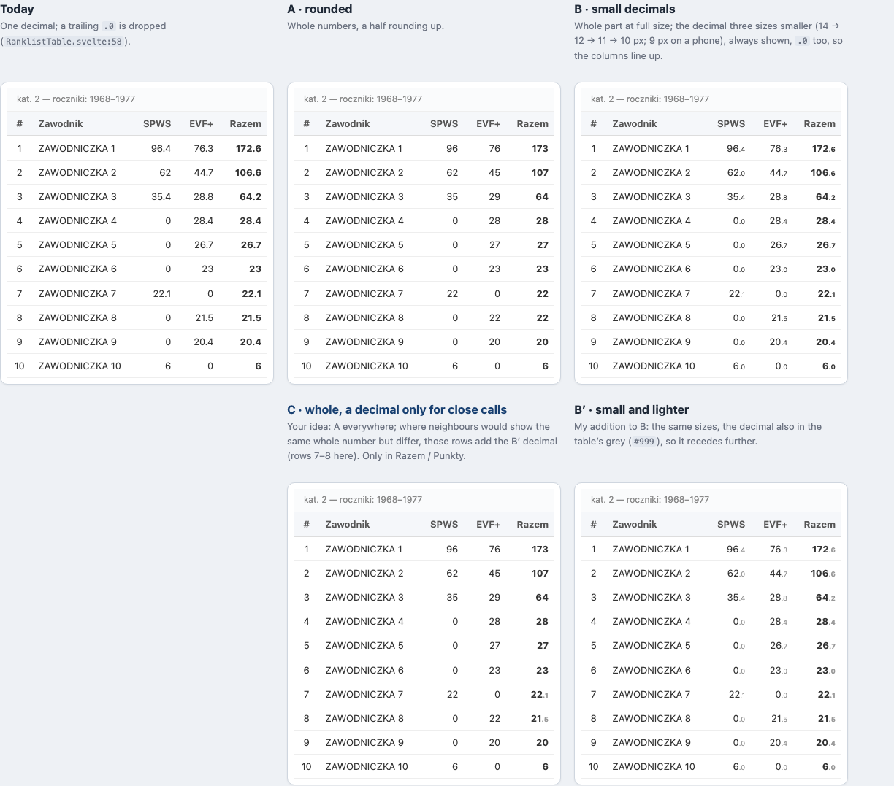
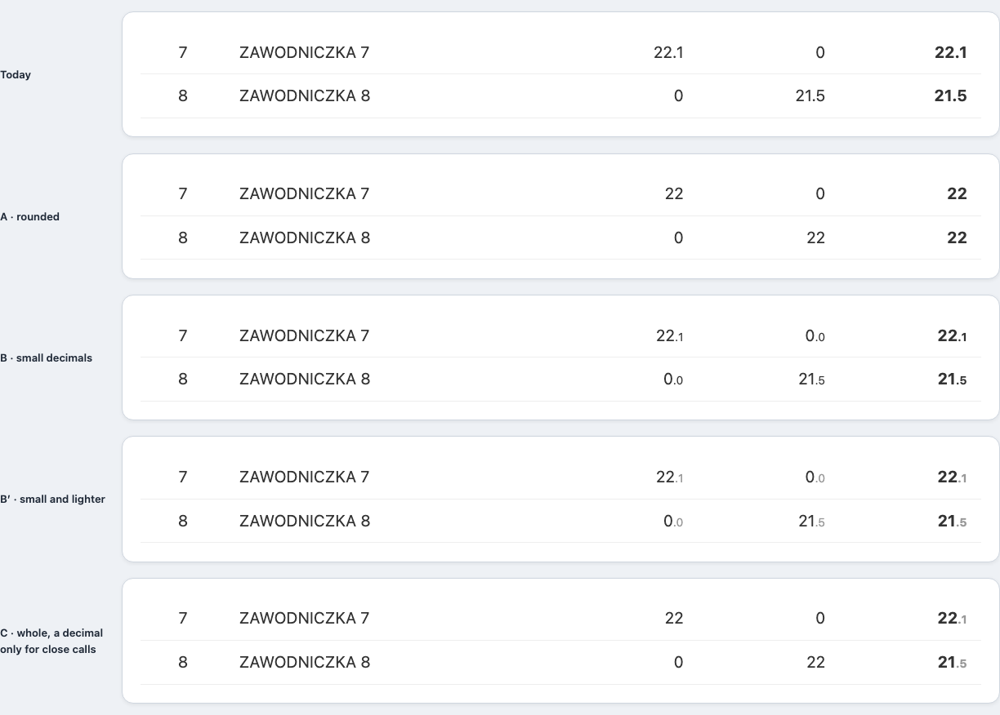

# ADR-114: The Main Ranklist Shows Whole Points; a Decimal Appears Only Where Neighbours Would Look Equal

**Status:** Accepted (decided by the user in chat on 2026-10-18: design C from the five-way mock, then the plan `doc/plans/ranklist-whole-points-2026-10-18.html` with S1 A and S2 A). Implemented test-first on LOCAL on 2026-10-18 (RT.ROUND.01–10); release pending the before/after sheet.
**Date:** 2026-10-18
**Relates to:** [ADR-101](101-ranking-ppw-public-ui-and-publication-boundary.md) (it owns the Ranking / PPW table and its columns; this record decides how their numbers read), [ADR-098](098-ranking-schema-v2-and-generalized-ranking-rpc.md) (its functions return the rank; their `ROW_NUMBER` order is recorded here, unchanged), [ADR-078](078-gdpr-data-handling.md) (why the committed mocks carry placeholder names), [ADR-102](102-published-pages-share-one-scoring-module.md) (the points calculator and the Points Table are untouched)
**Source:** `frontend/src/lib/ranklist-points.ts`, `frontend/src/components/RanklistTable.svelte`, `doc/plans/ranklist-whole-points-2026-10-18.html`, `doc/mockups/ranklist-whole-vs-small-decimals-2026-10-18.html`

## Context

The main ranklist showed one decimal on every number: `fmt` in `RanklistTable.svelte` rounded to one decimal and dropped a trailing `.0`, for Punkty in the PPW view and for SPWS, EVF+ and Razem in the Ranking view. Readers compare whole points, so the decimals cluttered the list without informing it. On 18 October 2026 the user asked to remove them from the main list and to keep them in the drilldown.

Measured on PROD that day as the site reads the lists, every weapon, gender and category, SELECT only. The active season 2026/27 is read with the rolling carry-over (`p_rolling` true: `frontend/src/lib/rolling.ts`, `shouldUseRolling`) and the past season 2025/26 without it:

| List | Neighbour pairs | Same whole number, totals differ | Same whole number, exact tie | Needs two decimals |
| --- | --- | --- | --- | --- |
| Ranking 2026/27 (rolling) | 227 | 9 | 4 | 1 |
| PPW 2026/27 (rolling) | 196 | 8 | 4 | 1 |
| PPW 2025/26 | 184 | 3 | 5 | 0 |
| All | 607 | 20 | 13 | 2 |

With whole numbers alone, the 20 pairs whose totals differ show two ranks with the same number and no visible reason for the order (épée men V1, Ranking: #5 171.39 and #6 170.94 both show `171`). Two of them still look equal at one decimal: épée women V0, #5 71.34 and #6 71.31, in both views. In 20 of 256 Ranking 2026/27 rows the rounded SPWS plus the rounded EVF+ misses the rounded Razem by one, as 96.35 + 76.25 = 172.60 shows `96 + 76 = 173`; a one-decimal display already misses by 0.1 there (`96.4 + 76.3 = 172.6`).

Every ranking function numbers its rows with `ROW_NUMBER() OVER (ORDER BY total DESC)` and no second key: `supabase/migrations/20261003000018_carry_stop_results.sql:222` (`fn_ranking_full_event_fk_matching`) and `:508` (`fn_ranking_ppw_event_fk_matching`), and the code-matching variants in `supabase/migrations/20260928000001_spws_place_medal_engine.sql:1220, :1337`. Exactly equal totals therefore take consecutive ranks in an order no rule fixes.

## Decision

### 1 · Whole points

Every number in the main table is whole, a half rounding up (`Math.round`): Punkty, SPWS, EVF+ and Razem. Stored scores have two decimals and any `x.50` is exact in binary, so a half is never misrounded. An empty value shows `—`.

### 2 · A decimal only for close calls, only in the column that orders the list

The exception applies to Razem in the Ranking view and Punkty in the PPW view. The list arrives sorted by that total and rounding never reorders, so rows showing the same whole number are always neighbours. When such a run's exact totals are not all equal, every row of the run shows its decimal: one, or two when one decimal would still show two different totals as equal. A run of exact ties stays whole, since no decimal can explain an order the database does not fix. SPWS and EVF+ stay whole even in a close-call row; they do not decide the order.

### 3 · How the decimal looks

The decimal is 0.72 em (10 px under the 14 px digits, 9.4 px under 13 px on a phone) in the table's grey `#999`. It is rendered as Svelte markup (``), never as raw HTML. The separator stays the point the table already used.

### 4 · What does not change

The drilldown keeps its one decimal and the ODS download keeps the exact values. The order, the rank, the column widths (100 px, 70 px on a phone), the points calculator and the Points Table are unchanged.

### 5 · One pure module

`frontend/src/lib/ranklist-points.ts` holds the rule: `wholePoints`, `closeCallDecimals` and `splitPoints`. `RanklistTable.svelte` derives the decimals from its rows and only draws them.

## Alternatives considered

1. **Keep one decimal everywhere.** Rejected: it is the clutter the user named.
2. **A · whole numbers only.** Rejected: two different ranks can show the same number with no visible reason.
3. **B · every decimal three sizes smaller.** Rejected: every number keeps a tail, `.0` on zeros and whole numbers included (a zero in 5 of the mock list's 10 SPWS cells). The list gets quieter, not clean.
4. **B′ · B in grey.** Rejected for the same reason, less loudly. Its look is kept for the close calls.
5. **Decimals in every column of a close-call row.** Rejected: SPWS and EVF+ do not decide the order, and the decimals would add clutter exactly where the signal sits.
6. **Always two decimals for a close call.** Rejected: one is enough in 18 of the 20 close calls PROD shows; two appear only where one is not (71.34 and 71.31).
7. **Shared ranks for equal totals.** Not decided here: it is a ranking rule, not a display (open item 1).

## Consequences

- New: `frontend/src/lib/ranklist-points.ts`, `frontend/tests/ranklistPoints.test.ts` (RT.ROUND.01–05), `doc/adr/assets/adr-114-phone-five-ways.png`, `doc/adr/assets/adr-114-close-call.png`, `doc/mockups/ranklist-whole-vs-small-decimals-2026-10-18.html`. Modified: `frontend/src/components/RanklistTable.svelte` (its own `fmt` is gone), `frontend/tests/RanklistTable.test.ts` (RT.ROUND.06–08), and two guards: `frontend/tests/DrilldownModal.test.ts` (RT.ROUND.09) and `frontend/tests/export.test.ts` (RT.ROUND.10).
- A row's look depends on its neighbours: a `22` becomes `22.1` while another fencer is within the same whole number, and goes back when they part.
- Those few rows break the clean right edge of the column by a small tail.
- The visible sum can miss by one; the drilldown shows the exact parts.
- **Found, not fixed:** equal totals take consecutive ranks in no fixed order (`ROW_NUMBER` without a second key).
- The committed mocks carry real scores and placeholder names: a fencer erased under ADR-078 must not survive in git history.

## Open items

1. **How equal totals are ranked.** Today they take consecutive ranks in no fixed order. Decided by the user on 2026-10-18 as its own ranking rule: equal totals share a place and the next place skips (16, 16, 18). It ships as its own change after this record, planned in [doc/plans/equal-totals-shared-place-2026-10-18.html](../plans/equal-totals-shared-place-2026-10-18.html) and recorded in its own ADR. This record keeps exact ties whole either way.

## The mocks

The five designs side by side on a phone. The scores are the real ones `fn_ranking_full` returned on PROD on 18 October 2026 for épée, women, category 2, 2026/27, read without the rolling carry-over, and the names are replaced by placeholders. The site shows the active season with the carry-over, so its rows differ; the design is the same. C, the chosen design, is under A:

Rows 7 and 8 of that list, the close call, at 140%. C differs from A only in Razem:

The full interactive mock, with the Ranking / PPW switch, the phone and desktop widths and the comparison table: [doc/mockups/ranklist-whole-vs-small-decimals-2026-10-18.html](../mockups/ranklist-whole-vs-small-decimals-2026-10-18.html).
